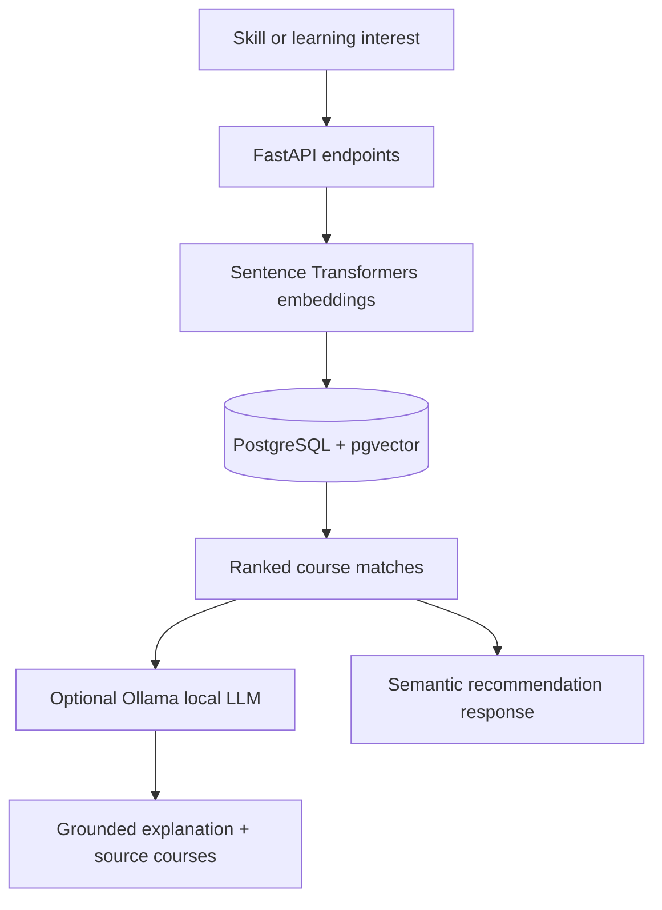

# AI Course Recommender — Semantic Search & RAG

A **backend prototype** for finding relevant university courses from user-specified skills or learning interests. The application retrieves courses with multilingual sentence embeddings stored in PostgreSQL/pgvector; an optional **local LLM** via Ollama produces answers grounded in retrieved course descriptions.

> **Scope:** The project is a course recommender, not a finished CV–job matcher. The skill extraction endpoint currently uses a fixed catalogue and regular expressions rather than an ML-based extractor. This repository contains backend code; no graphical frontend or hosted demo is included.

## Capabilities

- **Course API** to add and list courses.
- **Skill extraction** using a rule-based catalogue (prototype component).
- **Semantic recommendations** using `sentence-transformers/paraphrase-multilingual-MiniLM-L12-v2` (384-dimensional embeddings) and pgvector cosine distance.
- **RAG recommendations** combining retrieved courses with a local Ollama model; the response includes supporting course records.
- **Batch ingestion & embedding generation** from CSV and structured Åbo Akademi course JSONL.
- **Alembic database migrations**, including HNSW index on non-null embeddings.

## Dataset

The project uses university course information collected from publicly accessible sources. The original dataset is not included in this repository because it contains unprocessed information, including instructor names and contact details.


## Architecture



## Stack

Python · FastAPI · Sentence Transformers · PostgreSQL · pgvector · SQLAlchemy · Alembic · Ollama · httpx · pytest

## Local setup

Prerequisites: Python 3.11+ (subject to compatibility of the pinned dependencies), PostgreSQL with the **pgvector extension installed**, and optionally Ollama for the RAG endpoint.

1. Create a Python virtual environment and install dependencies:

   ```bash
   python -m venv .venv
   # Linux/macOS: source .venv/bin/activate
   # Windows PowerShell: .venv\Scripts\Activate.ps1
   pip install -r requirements.txt
   ```

2. Copy `.env.example` to `.env` and set your local database credentials. Create an empty PostgreSQL database named `course_recommender` (or update `DB_NAME`). Enable the vector extension in that database:

   ```sql
   CREATE EXTENSION IF NOT EXISTS vector;
   ```

3. Apply database migrations:

   ```bash
   alembic upgrade head
   ```

4. Start the API:

   ```bash
   uvicorn app.main:app --reload
   ```

5. Wait until the terminal displays "Application startup complete." before opening the API documentation at http://127.0.0.1:8000/docs
   
7. Open http://127.0.0.1:8000/docs for interactive API documentation. The first embedding request downloads the sentence-transformer model unless it is cached.
   

### Loading example courses

Use the included synthetic example rows without claiming they are actual university offerings:

```bash
# Copy demo data to the location expected by the importer
# Linux/macOS: cp data/courses.example.csv data/courses.csv
# Windows PowerShell: Copy-Item data/courses.example.csv data/courses.csv
python -m scripts.import_courses
python -m scripts.generate_embeddings
```

The importer **appends** rows, so running it repeatedly can create duplicates. The original Åbo Akademi JSONL importer (`scripts/import_aau_courses.py`) expects `data/raw/aau_courses.jsonl` in a specific course-section structure; the original data is not included here.

### Optional: run local RAG

Install and run Ollama separately, then fetch the model configured in `.env`, for example:

```bash
ollama pull qwen3:4b
```

Ollama must be reachable at `OLLAMA_BASE_URL`. The RAG endpoint depends on this service; semantic retrieval does not.

## Example API calls

Extract known skills from text (rule-based):

```bash
curl -X POST http://127.0.0.1:8000/api/v1/skills/extract -H "Content-Type: application/json" -d '{"text":"Experience with Python, SQL, FastAPI and Docker."}'
```

Retrieve matching courses (after loading courses and creating embeddings):

```bash
curl -X POST http://127.0.0.1:8000/api/v1/recommendations -H "Content-Type: application/json" -d '{"skill":"machine learning","limit":5}'
```

Generate a sourced answer using Ollama:

```bash
curl -X POST http://127.0.0.1:8000/api/v1/rag/recommendations -H "Content-Type: application/json" -d '{"skill":"Python programming","limit":3}'
```

Additional endpoints: `GET /health`, `GET /api/v1/courses`, and `POST /api/v1/courses`.

## Testing

```bash
pytest tests/ -q
```

Existing tests cover the skill-extraction endpoint and validation of empty requests; database-backed retrieval and RAG are **not currently covered** by automated integration tests. Test execution and full local database/Ollama setup have not been verified in this packaged snapshot.

## Current limitations and next steps

- Prototype uses a short, hard-coded rule-based skill catalogue; expand to model-based extraction if needed.
- No public frontend or deployment configuration is bundled.
- Add integration tests with a test PostgreSQL instance and mocked Ollama responses.
- Improve ingestion idempotency; the CSV importer currently appends without deduplication.
- Add sample API output screenshots and measured retrieval evaluation before making performance claims.

## Notes

The repository is provided as a portfolio code sample.
